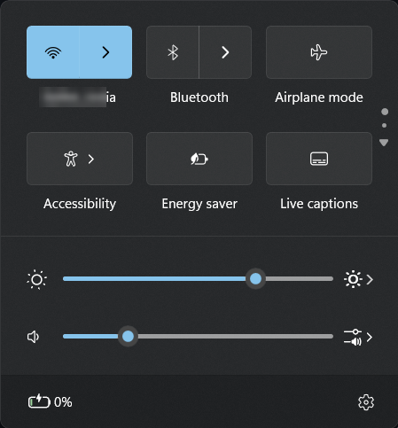
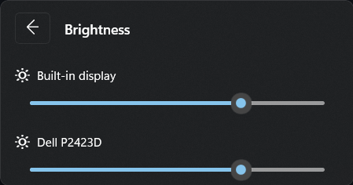
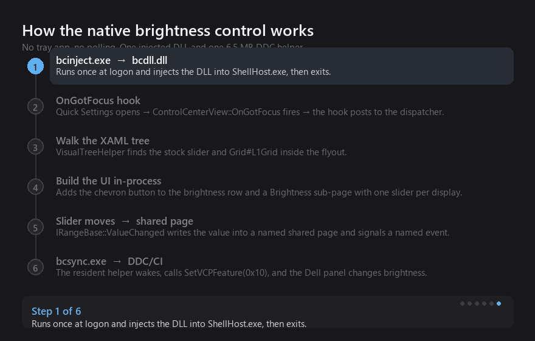

# brightness-control

Per-display brightness inside Windows 11 Quick Settings, over DDC/CI. No tray app,
no overlay window, no polling.



The chevron on the brightness row opens a sub-page with one slider per display,
and a back arrow to return:



## How it works



## Why it has to be an injected DLL

Windows 11's Quick Settings panel is a XAML island inside `ShellHost.exe`. It has
no enumerable window, no UI Automation provider, and it is composited in a higher
band than any ordinary window — a topmost overlay can neither cover it nor draw
on it. The only way to put a control *inside* that panel is to run code inside
`ShellHost.exe` and edit the panel's own XAML tree.

So this is not a skin or a clone of Quick Settings. It is the real panel, with a
few elements added to it.

## What runs

| Piece | Role | Size |
|---|---|---|
| `bcdll.dll` | Injected into `ShellHost.exe`. Hooks the flyout, adds the chevron and the Brightness sub-page, listens to the sliders. | 178 KB on disk |
| `bcsync.exe` | The resident agent. Keeps the DLL injected (including after Windows restarts the shell) and writes DDC/CI. | 5.9 MB working set |
| `bcinject.exe` | Manual injector, for debugging. The agent does this itself. | 158 KB, transient |

The C# tray app this replaced ran at ~37 MB.

## The flow

1. `bcsync.exe` starts at logon and injects `bcdll.dll` into every `ShellHost.exe`
   it finds. It watches those processes and re-injects whenever Windows restarts
   the shell, so the chevron keeps working without anyone re-running anything.
2. When Quick Settings opens, `ControlCenterView::OnGotFocus` fires. The hook
   records the view pointer and posts the real work to the DispatcherQueue —
   touching XAML from inside the hook itself takes the shell down.
3. The deferred pass walks the XAML tree and finds the stock brightness slider
   (`ControlCenter.AsyncSlider`, which implements `IRangeBase`) and `Grid#L1Grid`.
4. It appends a chevron button to the brightness row and builds a Brightness
   sub-page. Pressing the chevron collapses `L1Grid` and shows the sub-page; the
   back arrow reverses it.
5. Moving any slider raises `IRangeBase::ValueChanged`. The DLL writes the value
   into a named shared page and signals a named event.
6. `bcsync.exe` wakes, calls `SetVCPFeature(0x10)` over DDC/CI, and the external
   panel changes brightness.

The stock slider still mirrors onto the external panel, so the ordinary slider
and the Fn brightness keys keep working as before. The sub-page is only for
setting the two displays independently.

## Why a second process for DDC/CI

`GetPhysicalMonitorsFromHMONITOR` returns null handles for *every* monitor when
called from inside `ShellHost.exe`, on any thread. The identical enumeration works
from a normal process. So the VCP write lives in `bcsync.exe`; the DLL and the
helper share a named page and a named event, and the helper stays asleep until
there is something to write.

## Install

**[Download the latest release →](https://github.com/Huzbi-crypto/brightness-control/releases/latest)**

Extract the zip and run **`install.cmd`**. That is the whole process — no
administrator rights, no build tools, no command line.

The installer copies the files into `%LOCALAPPDATA%\BrightnessControl`, registers
a hidden logon launcher, starts the agent, and then waits until it has actually
attached to the shell before telling you it worked. If it cannot attach, it says
so instead of pretending.

Press **Win+A** afterwards. The chevron appears at the right end of the brightness
row, and stays there across reboots.

To remove it, run **`uninstall.cmd`** from the same folder. The chevron lingers
until the shell restarts, so sign out once after uninstalling.

### Requirements

- Windows 11. Only the build listed at the bottom has been tested. The hook
  patches one hardcoded address and checks the function's prologue first, so a
  Windows update that moves it disables the chevron rather than breaking the
  shell. See the last section of Limitations.
- A monitor with DDC/CI enabled in its own OSD menu. Most Dell/HP/LG panels ship
  with it on.

### If the chevron does not appear

Open `%LOCALAPPDATA%\BrightnessControl\native.log`. It records whether the agent
attached, whether the hook installed, and whether the chevron was built. If it
says `prologue mismatch`, Windows moved the hooked function — that needs a
rebuild, not a reinstall.

## Build from source

Only needed if you want to change the code. Requires Visual Studio Build Tools
with the C++ workload (MSVC and the Windows SDK). `build.cmd` finds the toolchain
with `vswhere` and calls `vcvars64`:

```
native\build.cmd
```

Output lands in `native\out\`. Put those three files next to `install.ps1` and run
the installer, or copy them into `%LOCALAPPDATA%\BrightnessControl` yourself.

## Limitations

- **The hook address is baked in.** `ControlCenterView::OnGotFocus` is patched at
  RVA `0xC0950`, read once from a specific `ControlCenter.pdb` with
  `native/tools/symtool`. A Windows update that moves that function will break the
  hook. It fails safe rather than crashing: the DLL checks the function's prologue
  bytes before patching and refuses if they don't match, so the worst case is a
  missing chevron, not a dead shell. Recovering means re-running `symtool` against
  the new `ControlCenter.dll` and rebuilding.
- Quick Settings can host more than one `ControlCenterView`, and it rebuilds the
  flyout's content between opens. The code walks every view it has seen and
  re-finds elements by name rather than trusting a cached pointer.
- Only the two displays on this machine were exercised: a laptop panel over WMI
  and a Dell P2423D over DDC/CI. A monitor with DDC/CI disabled in its OSD will
  not appear.
- The chevron is drawn with `Segoe Fluent Icons`. The shell's own button uses an
  `AnimatedIcon` (a Lottie asset), so the strokes are close but not identical.

## Repo layout

```
native/src/bcdll.cpp      the injected DLL: hooks, XAML tree, sliders
native/src/bcsync.cpp     the resident agent: injects, self-heals, writes DDC/CI
native/src/injector.cpp   bcinject.exe, the manual injector
native/tools/             PDB symbol reader and RTTI probe used during discovery
native/README.md          the long engineering log: what failed, and why
docs/                     screenshots and the animation
install.cmd / install.ps1       installs, autostarts, and verifies
uninstall.cmd / uninstall.ps1   removes everything again
```

`native/README.md` is worth reading before changing the hook. It records the wrong
turns — RTTI, wrong vtable slots, a heap corruption that made DDC look impossible —
so they don't have to be repeated.

## Verified on

Windows 11 (build 26300) · Intel UHD Graphics + NVIDIA MX250 · Dell P2423D over
HDMI · laptop panel via WMI.

## The old implementation

An earlier C# WinForms tray app is preserved on the **`old-implementation`**
branch. It works — it mirrors the panels and shows its own panel from the tray —
but it is a ~37 MB process and its panel sits outside Quick Settings. This
implementation replaces it.

## License

MIT
